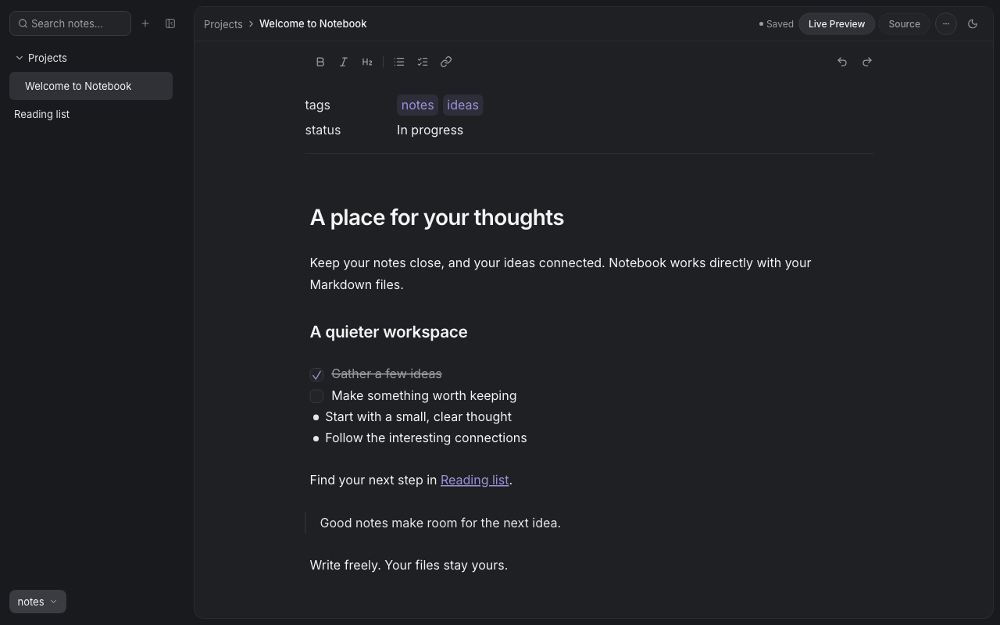

# Notebook

A Markdown notes app for Obsidian-style vaults. Ready for self-hosting.

Read and edit your notes from a browser with a Live Preview editor, and let agents
read them over MCP. Your `.md` files stay the source of truth: every edit is
written straight back to them, and text you did not touch is never rewritten.



## Installation

### Docker

```zsh
docker run -it \
  -p 127.0.0.1:8080:8080 \
  -v ~/notes:/vaults/notes \
  -e NOTEBOOK_VAULTS=notes=/vaults/notes \
  ghcr.io/danielfrg/notebook:latest
```

- Open [http://localhost:8080](http://localhost:8080)
- The container runs as UID/GID 65532, which needs write access to the mounted vault

Published images support Linux AMD64 and ARM64. `latest` tracks `main`.

### Standalone

Build a single executable with `just build` (see [Development](#development)),
then run:

```zsh
NOTEBOOK_VAULTS=notes=$HOME/notes ./notebook
```

Open [http://127.0.0.1:8080](http://127.0.0.1:8080).

## Usage

A vault is a folder of Markdown notes. List one or more in `NOTEBOOK_VAULTS` as
`name=/path`, separated by commas. A name starts with a lowercase letter or digit,
may also contain `_` and `-`, and is at most 32 characters.

Live Preview renders notes immediately when opened and reveals Markdown markers
at the cursor while the editor is focused; `Mod-e` switches
to Source mode. Changes save automatically, and a note that changed on disk in the
meantime shows a conflict instead of being overwritten. API documentation is at
`/api/docs`.

Use the **+** menu beside search to create a note or folder. A note or folder's actions
menu offers rename and delete; delete moves it to the vault's hidden `.trash`.
If a note changes on disk, choose **Load disk version** or **Overwrite**. If it
disappears, **Save as new note** keeps the editor text under a name you choose.

Search the current vault from the sidebar. `Mod-o` opens the quick switcher,
`Mod-p` opens commands, `Mod-Shift-f` focuses search, and `Mod-s` saves now
(`Mod` is Command on macOS or Control elsewhere). `[[wikilinks]]` resolve across
the vault; Command/Control-click follows a link. Local image embeds render in
Live Preview; remote images remain links. Tables remain Markdown text.

### Appearance

The theme control switches between dark, light, and system appearance. The accent
is configured with `--brand-accent` in `frontend/src/theme.css`; controls and note
links follow that variable. The theme file remains replaceable with the shared
homelab theme.

### MCP

Agents can read notes through the MCP endpoint at `/mcp` (Streamable HTTP).
Tools: `list_vaults`, `list_tags`, `list_notes`, `get_note`, and `search_notes`.
`list_tags` returns the tags used by visible notes and per-tag note counts.
`search_notes` accepts an optional `tag` alongside its keyword query, so an
agent can narrow a text search to a topic; nested tags count (for example,
`project` matches `project/alpha`).

The write tools `create_note`, `update_note`, and `append_to_note` exist only with
`NOTEBOOK_MCP_WRITE=true`, and never in read-only mode. Hide paths from every MCP
tool with `NOTEBOOK_MCP_EXCLUDE`, for example `notes:transcripts,notes:Private/**`.

MCP only accepts requests addressed to localhost. Behind a proxy, set
`NOTEBOOK_MCP_ALLOWED_HOSTS` to your public hostname.

### Security

There is no authentication: anyone who can reach the service can read and edit every
vault, so run it on a trusted network or behind an authenticated proxy.
Hidden paths and symlinks are inaccessible. MCP sees every visible note unless
excluded with `NOTEBOOK_MCP_EXCLUDE`; exclusions apply only to MCP.

## Configuration

| Variable                     | Default                                         |
| ---------------------------- | ----------------------------------------------- |
| `NOTEBOOK_ADDR`              | `127.0.0.1:8080`                                |
| `NOTEBOOK_VAULTS`            | required: `name=/path` entries, comma separated |
| `NOTEBOOK_READONLY`          | `false`                                         |
| `NOTEBOOK_MCP_WRITE`         | `false`                                         |
| `NOTEBOOK_MCP_EXCLUDE`       | unset (MCP can read every visible note)         |
| `NOTEBOOK_MCP_ALLOWED_HOSTS` | unset (MCP allows localhost only)               |
| `NOTEBOOK_API_TARGET`        | `http://127.0.0.1:8080` (frontend dev proxy)    |

Liveness is `/healthz`; readiness is `/readyz`.

## Development

Requires Go 1.25, Node 26, pnpm 10, and just.

Create a local configuration and vault once:

```zsh
cp .env.example .env
mkdir -p vaults/notes
```

Start the API and Frontend in two terminals:

```zsh
# Terminal 1:
just install
just api

# Terminal 2:
just frontend
```

Open [http://127.0.0.1:5173](http://127.0.0.1:5173). Vite proxies API requests
to the Go server. Run `just check` before sending changes. See `AGENTS.md` for
project structure and conventions.

## Build

```zsh
just build
```

```zsh
just image-check
```

The image check uses a temporary synthetic vault to verify embedded assets,
API writes and revision conflicts, exact BOM/CRLF preservation, MCP exclusions,
restart persistence, and trash. It requires Docker, Go, Python 3, and curl;
Linux bind-mount cleanup may require sudo. GitHub Actions runs this check on
AMD64 and ARM64 before publishing to GHCR.

The private homelab deployment is managed in
[`homelab/manifests/notebook`](https://github.com/danielfrg/homelab/tree/main/manifests/notebook).
